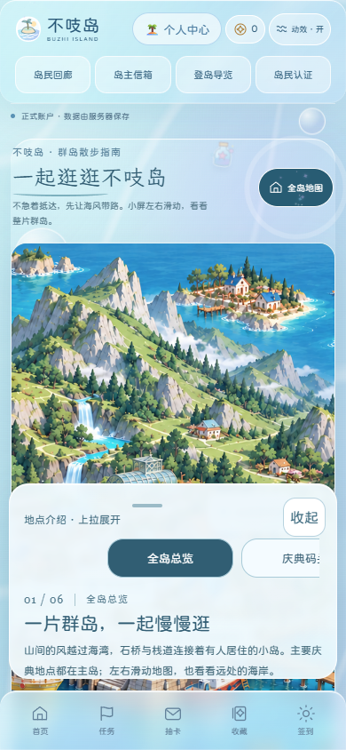

# 手机导览与实用交互验收

本地实现用户选定的 M2+M3，以及 A①③④+⑤；保留主页布局、原地图和原业务接口。

- 导览：手机底部面板支持收起/预览/展开；左右滑动地点卡同步地图，首末卡可居中；桌面显示全部地点，支持左右键，手机支持 Escape 收起；面板避让原底部导航。
- 收件箱：默认显示最近三封，可展开全部已加载来信；点击加载更早时自动展开，历史记录不会被折叠隐藏。领取成功邮戳在服务器确认且非重复领取后显示。
- 收藏：选中标签平滑切换，维持原筛选逻辑。
- 认证：填写资料/等待审核/认证完成步骤来自真实接口状态；保留草稿、审核反馈、账号隔离。
- 装饰：局部手绘线条与邮戳，支持原动效开关、系统减少动态效果，不改首页视觉。

## 定向验证

以下在本机临时 SQLite/虚构测试账户执行，未连接真实生产用户，未运行31项完整回归：

- `node tests/mobile-experience.cjs`：390/1440、手机末站滑动、桌面方向键、面板显示范围、筛选、认证步骤、信箱展开与确认后领取、无横向溢出、减少动态模式通过。
- `node tests/island-mail-browser.cjs`：390/1440，后台寄送、响应丢失后重试、金币和物品领取、持久化、文本安全、103封信的分页历史通过。
- `node tests/membership-dialog.cjs` 和 `node tests/membership-race.cjs`：390/1440，注册弹窗顺序、手动入口、草稿、审核状态、跨页入口、账号切换与延迟响应通过。
- `node tests/card-catalog.cjs` 和 `node tests/card-release.cjs`：46张目录、后台编辑卡名/等级、图片渲染、历史等级、首抽与重启持久化通过；补充服务器确认等级优先于页面缓存的回归。
- 独立静态审查：手机新交互未发现阻止合入的重要问题。
- CI补充验收：修复手绘线条后台暂停，`resident-appearance` 43项、`guide-alignment` 180项、`ambient-motion` 93项通过；按新认证弹窗流程更新旧断言，并修复小测成绩选择器歧义，失败的quiz-flow/membership-admin/production-layout定向复验通过。新手机交互测试已加入界面CI。

手机测试为 Chromium 触屏模拟，尚非 iPhone/Android 真机验收。

## 上线边界与交接

本轮没有部署、启动或重启腾讯云服务，没有修改生产数据库。此前已完成生产备份异机DPAPI加密转存及实际恢复，25张原数据表保持一致；配置在用户单独授权后加密备份。私密备份均在仓库外，未提交。

发布准备材料随分支保留，不能将准备好的部署脚本当作已经执行。最终上线仍需固定完整版本、检查实际发布包和生产当前状态，再执行已授权窗口。

2026-10-25 同步发现 main 新增 `625b2fb`，包含金币兑换码与部分认证/卡面修复；开发分支已完成冲突整合并保留这些新增成果；附加的12项信箱/兑换码定向测试与历史先于目录加载测试均通过。后台等级沿用main的card_profiles.rarity列，调整与历史数据保持兼容。
